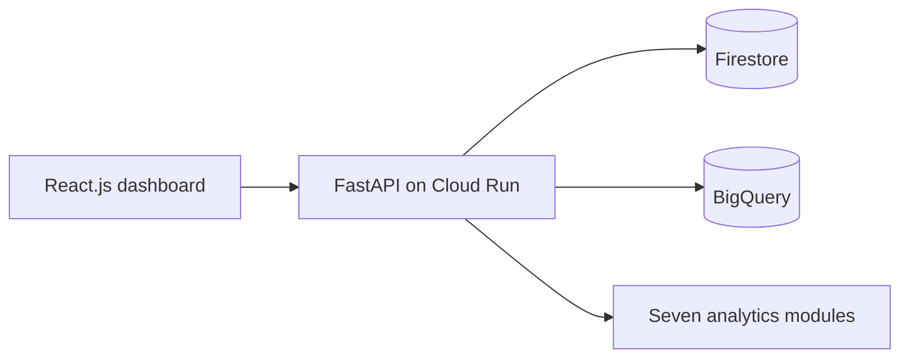
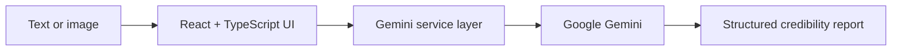
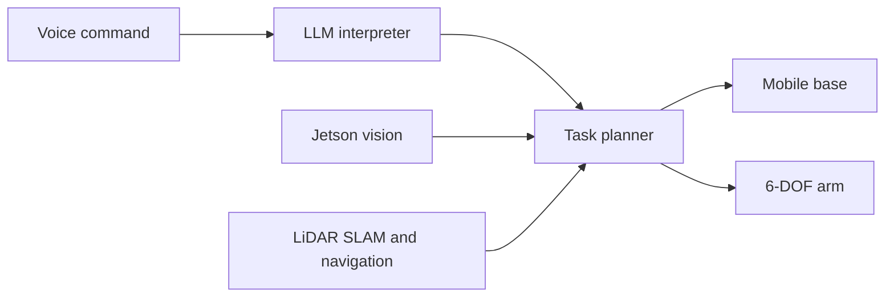

<!-- ===================== HEADER ===================== -->

  

  

  B.Tech Information Technology (2024-2028) · Saveetha Engineering College, Chennai

  
  
  

---

## About
I build AI, cloud and autonomous systems for supply chain and logistics, and I create the events and communities where other students learn and compete. Currently researching 6G network slicing for dynamic resource allocation.

---

## Recognition
| | |
|---|---|
| **SIPS 2026** | Finalist, IIM Bangalore (ChainSight) |
| **SIH 2026** | Selected in college round, Open Innovation (SIH-222) |
| **Gen AI Hackathon 2025-26** | Prefinalist (Trust AI) |
| **Megathon** | Led a national hackathon series: 600+ registrations, 4 lakh rupee prize pool |
| **Public speaking** | Four-time consecutive winner |

---

## Featured projects
*Click a project to expand.*

<b>ChainSight</b> · AI-powered supply chain intelligence · <i>SIPS 2026 Finalist</i>

 

Seven-module platform: supplier risk, disruption intelligence, route optimization, demand forecasting, ESG, scenario simulation and supplier health.

[View repository](https://github.com/Shriraamakrishanan/ChainSight-Final)

<b>Trust AI</b> · Content credibility analysis · <i>Gen AI Hackathon prefinalist</i>

 

Gemini-powered web app that analyzes text and images for misinformation and returns structured credibility insights.

[View repository](https://github.com/Shriraamakrishanan/Trust-AI)

<b>Autonomous Mobile Manipulator</b> · ROS 2 · <i>In development</i>

 

6-DOF arm on a ROS 2 base with LiDAR SLAM, Jetson-based vision and LLM voice interaction. Logistics variant selected in the SIH 2026 college round (SIH-222).

<b>6G Network Slicing</b> · Dynamic resource allocation · <i>Ongoing research</i>

 

Research on allocating network resources dynamically across network slices in 6G systems.

---

## Technical skills

  

| Area | Tools |
|---|---|
| AI and Cloud | Generative AI, LLMs, Google Gemini, Vertex AI, BigQuery, Firestore, Cloud Run, AWS |
| Robotics | ROS 2, LiDAR SLAM, NVIDIA Jetson, Edge AI |
| Core CS | Data Structures, Algorithms, OOP, DBMS, SQL, Linux |

---

## Leadership
- **Unstop Student Ambassador and Lead Organizer, Megathon**: Software and Hardware hackathons plus an Ideathon; volunteers, faculty coordination, logistics and judging for 120 finalist teams. I create opportunities and manage technical and non-technical events.
- **Student Coordinator, AIAscend 2026** (AWS and Kyndryl)

---

## GitHub activity

  <picture>
    <source media="(prefers-color-scheme: dark)" srcset="https://streak-stats.demolab.com?user=Shriraamakrishanan&theme=github-dark&hide_border=true">
    
  </picture>

  <picture>
    <source media="(prefers-color-scheme: dark)" srcset="https://github-readme-stats.vercel.app/api?username=Shriraamakrishanan&show_icons=true&theme=github_dark&hide_border=true">
    
  </picture>
  <picture>
    <source media="(prefers-color-scheme: dark)" srcset="https://github-readme-stats.vercel.app/api/top-langs/?username=Shriraamakrishanan&layout=compact&theme=github_dark&hide_border=true">
    
  </picture>

<!-- Optional: contribution snake (setup steps below). Remove this block if you skip it. -->

  <picture>
    <source media="(prefers-color-scheme: dark)" srcset="https://raw.githubusercontent.com/Shriraamakrishanan/Shriraamakrishanan/output/github-snake-dark.svg">
    
  </picture>

---

## Currently
- Building the Autonomous Mobile Manipulator
- Researching 6G network slicing
- Open to internships in AI/ML, cloud, robotics and software engineering

  

